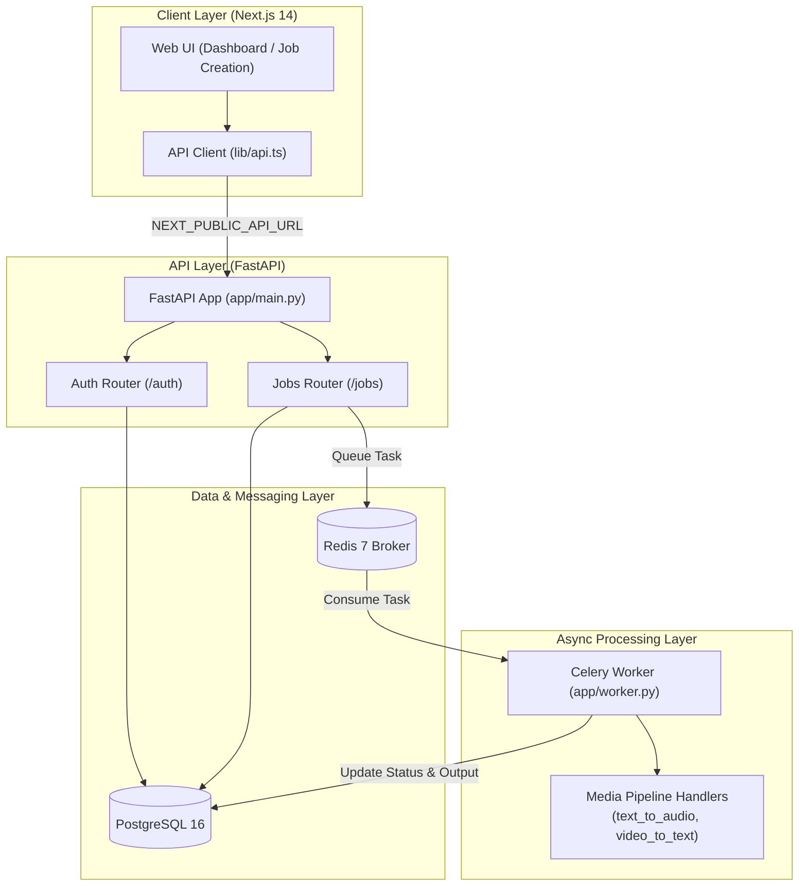

# 🎙️ Teodol Media Platform

A robust, full-stack media processing web application designed to handle advanced audio and video workflows—including text-to-audio conversion, video transcription, automated subtitle generation, intelligent summaries, and more.

## Architecture



## Backend (FastAPI)

### Auth Router

| Method | Endpoint | Description |
|--------|----------|-------------|
| `POST` | `/auth/register` | Validates email uniqueness, hashes the password with bcrypt, and creates the user with an initial 100 token balance |
| `POST` | `/auth/login` | Accepts OAuth2 form credentials, verifies the password, and issues a signed HS256 JWT |
| `GET` | `/auth/me` | Returns the current user's ID, email, and live token balance |

### Jobs Router

| Method | Endpoint | Description |
|--------|----------|-------------|
| `POST` | `/jobs` | Deducts tokens based on job type, records the job as `queued`, and dispatches it to Celery (falls back to sync processing if the broker is unavailable) |
| `GET` | `/jobs` | Lists the user's jobs, most recent first, with `id`, `kind`, `status`, `progress`, `input_key`, `output_key`, `token_cost`, and `created_at` |
| `GET` | `/jobs/{job_id}` | Returns a single job's status and output metadata for polling |

### Startup

- A connection-resilient `lifespan` handler retries automatically, so the API waits out PostgreSQL startup latency in Docker Compose.
- Tables (`users`, `jobs`) are created on startup via SQLAlchemy `Base.metadata.create_all`.

## Worker (Celery)

The worker lives in `app/worker.py` and is configured with:

```python
celery_app = Celery("teodol", broker=settings.redis_url, backend=settings.redis_url)
```

It uses JSON task and result serialization, UTC timestamps, and prefetch limits.

| Job type | What it does | Output |
|----------|--------------|--------|
| `text_to_audio` | Processes text from `job.input_key` and reports progress 25% → 75% → 100% | `outputs/{job_id}_speech.mp3` |
| `video_to_text` | Transcribes the video referenced by `job.input_key`, reporting progress until `completed` | `outputs/{job_id}_transcript.txt` |
| `audio_to_text`, `translate`, `summarize` | Fallback support | n/a |

If any unexpected exception occurs, the job is safely marked `failed`.

## Frontend (Next.js)

- **Environment:** `NEXT_PUBLIC_API_URL` defaults to `http://localhost:8000`. Use `frontend/.env.local` for standalone development and `.env` inside Docker Compose.
- **API client (`src/lib/api.ts`):** centralizes requests with typed interfaces, JWT storage in `localStorage`, error parsing, and automatic auth headers.

### Pages

| Route | Description |
|-------|-------------|
| `/dashboard` | Backend connectivity badge, account status, live token counter, and a jobs table with status indicators (`queued`, `processing`, `completed`, `failed`), progress bars, and output links |
| `/jobs/new` | Job type selector showing token costs, an input area, and a link to inspect the new job's progress |
| `/projects`, `/files`, `/team`, `/api-keys`, `/analytics`, `/settings` | Placeholder pages so no sidebar link is broken |

## Docker Compose Services

| Service | Description | Port |
|---------|-------------|------|
| `db` | PostgreSQL 16 with healthcheck | `5432` |
| `redis` | Redis 7 | `6379` |
| `backend` | FastAPI via `uvicorn app.main:app --host 0.0.0.0 --port 8000 --reload` | `8000` |
| `worker` | Celery via `celery -A app.worker.celery_app worker --loglevel=info` | n/a |
| `frontend` | Next.js | `3000` |

## ✨ Features

- Text-to-Audio: Convert written documents or notes into natural-sounding audio files.

- Video-to-Text Transcription: Accurately transcribe spoken dialogue from video files.

- Automated Subtitles: Generate timed subtitle tracks for media content.

- Content Summaries: Condense lengthy transcripts and documents into concise summaries.

- Background Processing: Powered by Celery and Redis to handle heavy media workloads asynchronously without blocking the UI.

## 🛠️ Tech Stack

- Frontend: Next.js, TypeScript, Tailwind CSS

- Backend: FastAPI, SQLAlchemy, Python

- Database: PostgreSQL

- Task Queue & Caching: Redis, Celery

- Containerization: Docker & Docker Compose

  ## 📁 Project Layout
```text
.
├── backend/
│   └── app/
│       ├── core/         # Configuration and security helpers
│       ├── routers/      # API route endpoints
│       └── worker.py     # Background job processing (Celery)
├── frontend/
│   └── src/
│       ├── app/          # Next.js pages and routing
│       └── components/   # Reusable UI components
├── docker-compose.yml
└── README.md
```

## 🚀 Running Locally

- Follow these instructions to get the application up and running on your local machine using Docker.

## Prerequisites

Ensure you have Docker and Docker Compose installed on your system.

## Setup Steps

1. **Clone the repository:**

```bash
   git clone https://github.com/jteodol06-hub/Teodol-media-platform2.git
   cd Teodol-media-platform2
```

2. **Configure environment variables:**

   Copy the example environment file and fill in your custom configurations:

```bash
   cp .env.example .env
```

   Open the newly created `.env` file and add your database URLs, secret keys, and any external API credentials.

3. **Build and start the containers:**

```bash
   docker compose up --build
```

4. **Access the application:**

   - Frontend UI: http://localhost:3000
   - Backend API Docs (Swagger): http://localhost:8000/docs

## Layout
- `backend/app/core` config, security helpers
- `backend/app/routers` API routes
- `backend/app/worker.py` background job processing
- `frontend/src/app` pages | `frontend/src/components` UI
## 📄 License
This project is open-source and available under the MIT License.
